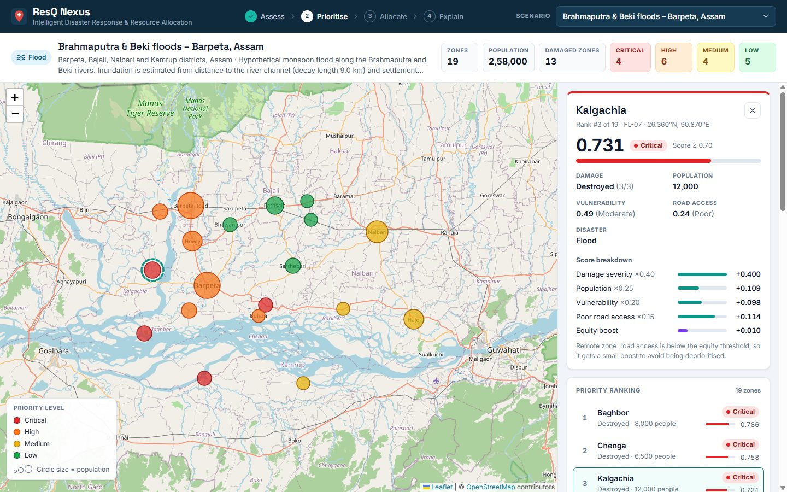

# ResQ Nexus

**Intelligent Disaster Response and Resource Allocation System**: a web-based decision-support tool
that helps a response team decide where help is needed first, what to send, and why.

It follows a four-stage pipeline: **Assess → Prioritise → Allocate → Explain**.

| Stage | What it does | Status |
|---|---|---|
| **Assess** | Load a disaster scenario: affected zones with damage, population, vulnerability and road access, plus the relief resources available | ✅ Done |
| **Prioritise** | Score every zone with a transparent weighted formula plus an equity adjustment, then rank it as Critical / High / Medium / Low | ✅ Done |
| **Allocate** | Distribute rescue teams, medical kits, food packets, shelters and vehicles across zones by priority | ⏳ Next stage (placeholder button in the UI) |
| **Explain** | Plain-language reasoning for every allocation, generated with Google Gemini | ⏳ Next stage (Gemini client already wired) |



## Features (current stage)

- **Three demo scenarios in real Indian regions**: Brahmaputra floods in Barpeta (Assam), an M6.9
  earthquake in Kachchh (Gujarat) and forest fires in Almora & Bageshwar (Uttarakhand). Each has
  19 zones at real OpenStreetMap locations plus a stock of relief resources.
- **Scenario generator** (`backend/generate_scenario.py`) that creates new random scenarios in the
  same format, either from real localities in a preset region or as synthetic zones anywhere.
- **Priority scoring service** with normalised factors, configurable weights, an equity boost for
  remote areas and pytest unit tests.
- **Dashboard** (React + Leaflet): zones as circle markers coloured by priority and sized by
  population, zone details with a score breakdown, a ranked list, a resource summary, and
  placeholders for the Allocate and Explain stages.

## Tech stack

| Layer | Tools |
|---|---|
| Frontend | React 19, Vite 8, React-Leaflet 5 / Leaflet 1.9, OpenStreetMap tiles, oxlint |
| Backend | Python 3.11+ (tested on 3.13), FastAPI, Pydantic 2, Uvicorn, pytest |
| AI | Google Gemini API (`google-genai`), used by the upcoming Explain stage |

The project started from the Script Desk template (React/Vite frontend, FastAPI backend, Gemini
client); its script-writing features and branding were removed.

## Project structure

```
resq-nexus/
├── backend/
│   ├── main.py                  FastAPI app and endpoints
│   ├── generate_scenario.py     random scenario generator (CLI)
│   ├── services/
│   │   ├── scenarios.py         scenario schema (Pydantic) and file loader
│   │   ├── priority.py          priority scoring, all settings in PRIORITY_SETTINGS
│   │   └── gemini_client.py     Google Gemini client (for the Explain stage)
│   ├── data/
│   │   ├── regions.json         region presets: real localities, river lines, reference hazards
│   │   └── scenarios/           flood-assam.json, earthquake-kutch.json, wildfire-kumaon.json
│   ├── tests/                   pytest suite
│   ├── requirements.txt         runtime dependencies
│   ├── requirements-dev.txt     + pytest
│   └── .env.example             copy to .env and add your Gemini key
├── frontend/
│   ├── src/
│   │   ├── App.jsx              data loading and page layout
│   │   ├── api.js               API client
│   │   ├── constants.js         colours, labels, number formatting
│   │   └── components/          TopBar, ScenarioSummary, ZoneMap, ZoneDetails,
│   │                            PriorityList, ResourceSummary, AllocationPanel
│   └── .env.example             optional: API address for the dashboard
├── docs/dashboard.jpg
└── .github/workflows/ci.yml     tests, lint and build on every push
```

## Getting started

### Prerequisites

- **Python 3.11 or newer** (tested with 3.13)
- **Node.js 20.19+ or 22.12+** (required by Vite 8)

### 1. Backend (FastAPI)

```bash
cd backend
python -m venv venv
venv\Scripts\activate              # Windows
# source venv/bin/activate         # macOS / Linux
python -m pip install -r requirements-dev.txt
copy .env.example .env             # Windows  (macOS / Linux: cp .env.example .env)
uvicorn main:app --reload
```

The API runs at <http://localhost:8000>; interactive docs are at <http://localhost:8000/docs>.

**Gemini key:** open `backend/.env` and set `GEMINI_API_KEY=` to your key from
<https://aistudio.google.com/apikey>. This stage does not call Gemini, so the API and dashboard run
without a key; `GET /health` shows whether one is configured. `.env` is git-ignored, so never commit it.

### 2. Frontend (React + Vite)

In a second terminal:

```bash
cd frontend
npm install
npm run dev
```

Open <http://localhost:5173>. The dashboard calls the API at `http://localhost:8000`. To use another
address, copy `frontend/.env.example` to `frontend/.env.local` and change `VITE_API_BASE_URL`.

### 3. Tests and checks

```bash
cd backend
python -m pytest              # 62 tests: scoring, schema, generator, API, demo data

cd ../frontend
npm run lint                  # oxlint
npm run build                 # production build into frontend/dist
```

The same checks run on GitHub Actions for every push (`.github/workflows/ci.yml`).

### Troubleshooting

- **"Cannot reach the ResQ Nexus API"** in the dashboard: the backend isn't running, or it runs on another
  port. Start it with `uvicorn main:app --reload` in `backend/` and press **Retry**.
- **Port 8000 already in use:** run `uvicorn main:app --reload --port 8001` and set
  `VITE_API_BASE_URL=http://localhost:8001` in `frontend/.env.local`.
- **PowerShell refuses to run `activate`:** run
  `Set-ExecutionPolicy -Scope CurrentUser RemoteSigned` once, or use Command Prompt.

## API endpoints

| Method | Path | Returns |
|---|---|---|
| GET | `/health` | `{"status": "ok", ..., "gemini_configured": false}` |
| GET | `/scenarios` | List of scenarios: `id`, `name`, `disaster_type`, `region`, `state`, `zone_count`, `total_population`, `synthetic` |
| GET | `/scenarios/{id}` | The full scenario: metadata, hazard parameters, available `resources` and every zone |
| GET | `/scenarios/{id}/priority` | Zones sorted by priority with `rank`, `priority_score`, `priority_level`, normalised `factors` and weighted `contributions`, plus a `summary` (zones per level) and the `settings` used |

Unknown scenario ids return `404`. Example (first zone only):

```bash
curl http://localhost:8000/scenarios/flood-assam/priority
```

```json
{
  "scenario_id": "flood-assam",
  "scenario_name": "Brahmaputra & Beki floods – Barpeta, Assam",
  "disaster_type": "flood",
  "summary": { "Critical": 4, "High": 6, "Medium": 4, "Low": 5 },
  "zones": [
    {
      "id": "FL-08",
      "name": "Baghbor",
      "latitude": 26.21744,
      "longitude": 90.8494,
      "disaster_type": "flood",
      "damage_severity": 3,
      "population": 8000,
      "vulnerability_index": 0.68,
      "accessibility": 0.05,
      "priority_score": 0.7863,
      "priority_level": "Critical",
      "rank": 1,
      "factors": { "severity": 1.0, "population": 0.2644, "vulnerability": 0.68, "inaccessibility": 0.95 },
      "contributions": {
        "severity": 0.4,
        "population": 0.0661,
        "vulnerability": 0.136,
        "accessibility": 0.1425,
        "equity_adjustment": 0.0417
      }
    }
  ]
}
```

## Priority model

Implemented in `backend/services/priority.py`:

```
priority = w1·severity + w2·population + w3·vulnerability + w4·(1 − accessibility) + equity_adjustment
```

Each factor is normalised to 0–1 first:

| Factor | Normalisation | Default weight |
|---|---|---|
| severity | `damage_severity / 3` | w1 = 0.40 |
| population | min–max across the scenario's zones on a log scale, so one large town doesn't flatten every village to 0 (set `"population_scaling": "linear"` for plain min–max) | w2 = 0.25 |
| vulnerability | `vulnerability_index` (already 0–1) | w3 = 0.20 |
| accessibility | used as `1 − accessibility`, so poor road access raises priority | w4 = 0.15 |

**Equity adjustment.** A damaged zone whose road access is below **0.30** gets a small extra boost
that grows linearly to **+0.05** at access 0. Remote areas are the ones most likely to be served
last because they are hard to reach; the boost keeps them from being deprioritised for that reason.
Undamaged zones get no boost.

**Levels.** Critical ≥ 0.70, High ≥ 0.50, Medium ≥ 0.30, otherwise Low.

**Configuration.** Every number above (weights, scaling, equity threshold and size, level
thresholds) lives in the single `PRIORITY_SETTINGS` dict at the top of `priority.py`.
`score_zones(zones, settings)` also accepts a modified copy for experiments.

**Worked example** (Kalgachia, flood scenario, shown in the screenshot):

| Factor | Value | Normalised | × weight |
|---|---|---|---|
| Damage | 3 (destroyed) | 1.000 | 0.400 |
| Population | 12,000 | 0.437 | 0.109 |
| Vulnerability | 0.49 | 0.490 | 0.098 |
| Road access | 0.24 | 1 − 0.24 = 0.760 | 0.114 |
| Equity boost | access 0.24 < 0.30 | 0.05 × (0.30 − 0.24) / 0.30 | 0.010 |
| **Priority** | | | **0.731 → Critical** |

## Scenario data

### Format

Each scenario is one JSON file in `backend/data/scenarios/<id>.json` (the file name is the id):

```json
{
  "id": "flood-assam",
  "name": "Brahmaputra & Beki floods – Barpeta, Assam",
  "disaster_type": "flood",
  "region": "Barpeta, Bajali, Nalbari and Kamrup districts",
  "state": "Assam",
  "description": "Hypothetical monsoon flood along the Brahmaputra and Beki rivers. ...",
  "synthetic": true,
  "data_note": "SYNTHETIC demo data. ...",
  "hazard": { "model": "river-distance", "rivers": ["Brahmaputra", "Beki"], "extent_km": 9.0 },
  "generator": { "script": "generate_scenario.py", "seed": 8, "preset_hazard": true, "scarcity": 0.6 },
  "resources": { "rescue_teams": 8, "medical_kits": 1530, "food_packets": 38300, "shelters": 194, "vehicles": 16 },
  "zones": [
    {
      "id": "FL-07", "name": "Kalgachia", "latitude": 26.36013, "longitude": 90.87007,
      "disaster_type": "flood", "damage_severity": 3, "population": 12000,
      "vulnerability_index": 0.49, "accessibility": 0.24
    }
  ]
}
```

| Zone field | Meaning |
|---|---|
| `damage_severity` | 0 none, 1 minor, 2 major, 3 destroyed |
| `population` | residents in the zone |
| `vulnerability_index` | 0–1; 1 = most vulnerable (e.g. poverty, weak housing, elderly residents) |
| `accessibility` | 0–1; 1 = easy road access, 0 = cut off |

Resources are counted as rescue teams, medical kits (about 1 per 25 affected people), one-day food
packets, shelter units (about 100 people each) and vehicles (trucks, boats, ambulances).

### Demo scenarios

| id | Disaster | Region | Zones | What to look at |
|---|---|---|---|---|
| `flood-assam` | Brahmaputra & Beki floods | Barpeta, Bajali, Nalbari and Kamrup districts, Assam | 19 | Riverine *char* villages cut off by water (Baghbor, Chenga) top the list |
| `earthquake-kutch` | M6.9 earthquake (hypothetical, in the source zone of the 2001 Bhuj earthquake) | Kachchh, Gujarat | 19 | Bhachau is destroyed and ranks first; remote Dholavira on Khadir Bet is lifted by the equity boost |
| `wildfire-kumaon` | Pre-monsoon forest fires from three ignition areas (Binsar, Syahi Devi, Jageshwar) | Almora & Bageshwar, Uttarakhand | 19 | Forest-edge hamlets with poor road access outrank larger towns |

> **This is synthetic demo data.** Zone names and coordinates are real places (OpenStreetMap via
> Nominatim; river lines from OpenStreetMap). Populations are rounded approximations. Damage,
> vulnerability, accessibility and resource figures come from the generator's hazard model and are
> not real observations. Every file carries `"synthetic": true` and a `data_note` saying so.

The three files were produced with the generator, so they can be regenerated:

```bash
cd backend
python generate_scenario.py --type flood      --region assam-barpeta --preset-hazard --seed 8  --id flood-assam      --force
python generate_scenario.py --type earthquake --region kutch         --preset-hazard --seed 31 --id earthquake-kutch --force
python generate_scenario.py --type wildfire   --region kumaon        --preset-hazard --seed 14 --id wildfire-kumaon  --force
```

### Generating new scenarios

```bash
cd backend
python generate_scenario.py --list-regions

# Random earthquake in Kutch: random epicentre and magnitude, real localities
python generate_scenario.py --type earthquake --region kutch --seed 42

# 15 of the Kumaon localities with random fire ignition points, printed instead of saved
python generate_scenario.py --type wildfire --region kumaon --zones 15 --stdout

# Synthetic zones anywhere in India (here around Darbhanga, Bihar)
python generate_scenario.py --type flood --center 26.15,85.90 --radius-km 30 --region-name "Darbhanga, Bihar" --state Bihar
```

New files go to `backend/data/scenarios/<id>.json` and appear in the dashboard's dropdown after a
page refresh (no restart needed). Useful options: `--seed` (reproducible), `--zones 15-20`,
`--magnitude`, `--scarcity` (resources as a fraction of the estimated need), `--id`, `--name`,
`--out`, `--force` (overwrite; existing files are otherwise protected). Run with `--help` for all options.
`--center` scatters zones evenly within the radius and doesn't know where the coast is, so near the
sea pick an inland centre or a smaller `--radius-km`.

**How damage is generated.** Each disaster type has a simple, explainable hazard model:

- earthquake: intensity `1 / (1 + (d/D)²)` from the epicentre, where `D` grows with magnitude
- flood: `exp(−d / extent)` from the river lines (the real Brahmaputra and Beki centrelines for Assam)
- wildfire: `exp(−d / spread)` from the nearest ignition area

A settlement-type adjustment is added (riverine and forest-edge hamlets are more exposed, cities
less), then noise. Intensity maps to damage 3 / 2 / 1 / 0 at 0.70 / 0.45 / 0.20. Road access falls
as intensity rises. Available resources are a fraction of the estimated need, so the Allocate
stage has real trade-offs to make.

## Next stages

- **Allocate:** turn the ranked zones and the resource stock into a recommended distribution (the
  **Allocate Resources** button and the **Allocation & Explanation** panel are already in place).
- **Explain:** use `backend/services/gemini_client.py` (`generate_text(prompt)`) to explain each
  decision in plain language from the score breakdown returned by `/priority`.

## Credits

- Map data © [OpenStreetMap contributors](https://www.openstreetmap.org/copyright) (ODbL). Map
  tiles come from `tile.openstreetmap.org`, which suits light demo use under the OSM tile usage policy.
- Built on the Script Desk template (React/Vite + FastAPI + Google Gemini).
