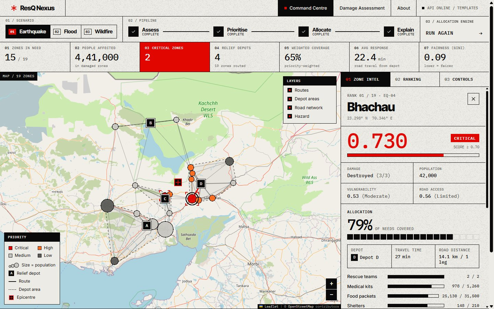
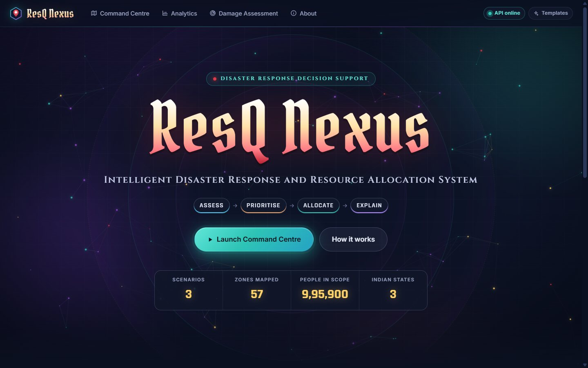
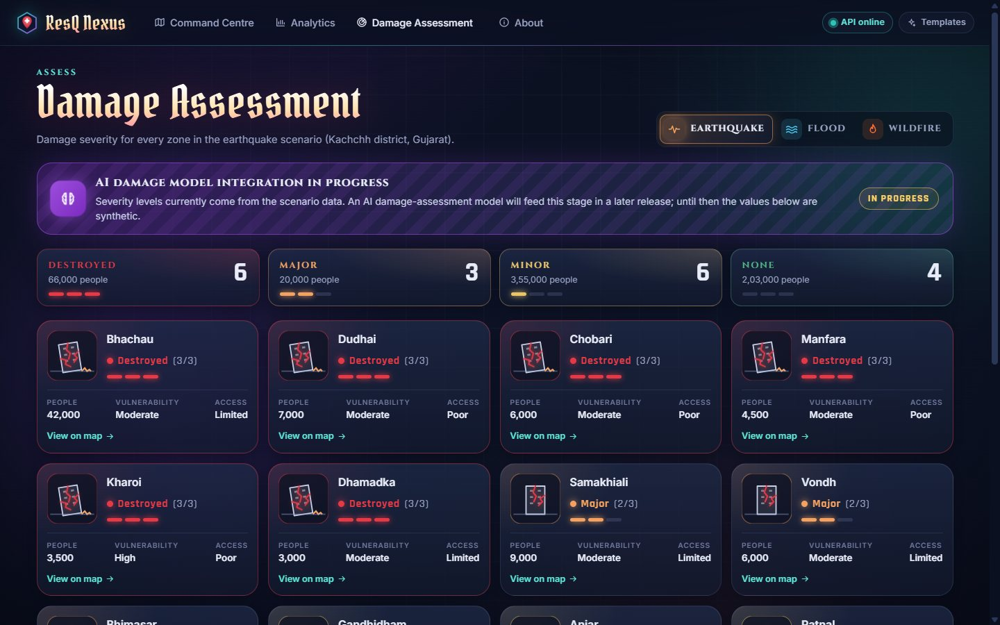
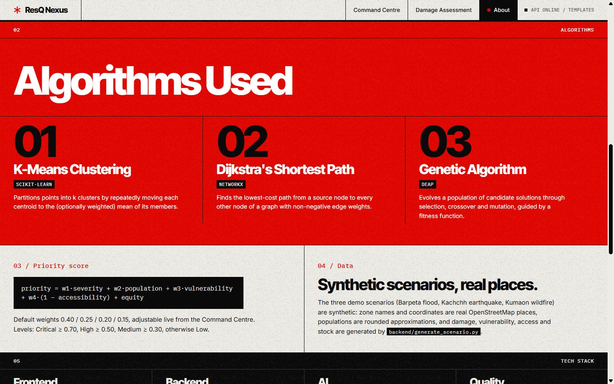

# ResQ Nexus

**Intelligent Disaster Response and Resource Allocation System**: a web-based decision-support tool
that helps a response team decide where scarce relief should go first, what to send, and why.

It follows a four-stage pipeline: **Assess → Prioritise → Allocate → Explain**.

| Stage | What it does |
|---|---|
| **Assess** | Load a disaster scenario: affected zones with damage, population, vulnerability and road access, plus the relief stock available |
| **Prioritise** | Score every zone with a transparent weighted formula plus an equity adjustment, and rank it Critical / High / Medium / Low. The weights can be changed live |
| **Allocate** | The **Allocation Engine** turns the scores and the stock into a plan: units of every resource per zone, a relief depot, a road route and a travel time. The API also returns a greedy baseline for comparison |
| **Explain** | Google Gemini writes a short plain-language reason for every zone's share. Without a key (or if the API fails) template explanations are used, so the demo never breaks |



## Features

- **Accounts and roles:** citizens register themselves; service providers register their
  organisation (name, type, location on a map) and wait for admin approval; admins run the
  control room. Passwords are hashed with bcrypt, logins are JWTs, and each role lands on its own
  dashboard. Protected pages send visitors to the login page, which has one-click **Demo Login**
  buttons (see [Roles and demo accounts](#roles-and-demo-accounts)).
- **SOS emergency (citizen):** a very large red SOS button, a confirm step, browser geolocation (or
  a pin dropped on the map if location is denied), and the request is saved with its location at
  once. The Emergency Details form follows (type, people affected, injuries, needs, vulnerable
  people, description, phone). A status tracker (PENDING → ACKNOWLEDGED → DISPATCHED → RESOLVED)
  shows timestamps and the assigned responder and refreshes every 10 seconds; **My Requests** lists
  past requests. A fixed notice says the prototype is not connected to emergency services (call 112).
- **Nearby resources (citizen):** hospitals, ambulances, shelters, food and water points, fire and
  police stations near the user, on a map with a square/geometric marker per type and in a list
  sorted by distance (haversine), with type filters, a radius selector, availability, status
  (OPEN / FULL / CLOSED), phone and last update.
- **Service provider dashboard:** counters, requests assigned to the organisation and nearby
  unassigned ones on a map and list, **Accept** then **Dispatched** / **Resolved**, and an editor
  for the organisation's own capacity and status.
- **Admin dashboard:** the **SOS monitor** (animated counters, a live map of every request coloured
  by severity, status and type filters, **Suggest nearest provider** and **Assign**), provider
  approvals, resources and users. The Command Centre is admin-only and has an **Include live SOS**
  option: each active SOS adds to the demand of its nearest zone (within 30 km) before the
  Allocation Engine runs.
- **Data notice:** a thin bar at the top of every page and a Data Notice on About: roads, facilities and
  population are real (OpenStreetMap, WorldPop); damage values in the Indian scenarios are simulated.
- **Landing page:** a full-width ResQ Nexus wordmark, live scenario figures with counting mono
  numbers, a red problem statement, a black project section with a photograph and the
  **Launch Command Centre** button, and a card for each demo scenario.
- **Command Centre** (main dashboard):
  - scenario selector (flood / earthquake / wildfire)
  - a large OpenStreetMap map in its original colours: zones coloured by priority and sized by
    population, blinking corner brackets on Critical zones, the hazard (earthquake epicentre, fire
    ignition areas), square relief depots, depot areas, the road network, and solid route lines
    that draw in from each depot to its zones
  - priority weight sliders that re-score and recolour the zones live
  - **Run allocation** switches the pipeline stepper step by step while the engine runs; changing
    the weights afterwards marks the plan as out of date until it is re-run
  - KPI strip with counting numbers: zones in need, people affected, Critical zones, depots,
    priority-weighted coverage, average response time and the Gini fairness score
  - side panel: the selected zone's details and score breakdown, its allocated resources against
    its need, depot, travel time, road distance, a coverage meter and the explanation; plus a
    ranked list and the resource stock
  - toast notifications, loading and error states, keyboard access (Tab to a zone, Enter to
    select), and shareable links (`/command?scenario=earthquake-kutch&zone=EQ-04`)
- **Damage Assessment:** every zone's severity with disaster-type glyphs, per-level totals and an
  "AI damage model integration in progress" banner.
- **About:** project overview, how it works, Algorithms Used, the priority score, the data, the
  tech stack and photo credits.
- **Analytics** (hidden for now, see [Feature flags](#feature-flags)): Allocation Engine vs greedy
  cards and charts for every metric, the GA fitness-over-generations chart, resource distribution
  per zone and per depot, a coverage fairness (Lorenz) curve and coverage by zone.
- **Four demo scenarios in real South Indian regions** and a **scenario generator** for new ones.
- Built for presenting in a desktop browser: laptops and 1280×720 projectors up to full HD,
  respects "reduce motion", and the production build splits each page into its own chunk.

| Landing page | Damage Assessment | About |
|---|---|---|
|  |  |  |

## Design

The interface follows an editorial brutalist style: raw concrete, heavy type, hard edges and a
visible grid.

- **Colour:** black `#0A0A0A`, paper `#EDEBE6`, concrete `#8A8A85` and `#C9C7C1`, signal red
  `#E10600` as the one strong accent, and a little orange `#FF6B1A` for high-priority states.
  Full-width black, paper and red sections alternate down each page. A faint noise texture gives
  the paper and black sections a concrete grain.
- **Type:** Inter Tight 800 for headings (very large, tight letter-spacing), Inter for body text
  and IBM Plex Mono for labels, data, coordinates and metrics.
- **Layout:** a strict grid of 1px rules. No rounded corners, shadows, gradients or blur. Buttons
  are rectangular and invert their colours on hover. Section numbers, small mono corner labels,
  large standalone numerals and an asterisk brand mark repeat across the pages.
- **Photographs:** high-contrast grayscale photographs of concrete buildings, flood, earthquake,
  wildfire and cyclone damage, stored in `frontend/src/assets/photos/` (see [Credits](#credits)).
- **Map:** standard OpenStreetMap tiles in their original colours, so towns, roads, rivers and
  terrain stay easy to read (no API key needed). The overlays follow the site's style: priority
  colours Critical `#E10600`, High `#FF6B1A`, Medium `#C9C7C1`, Low `#5A5A57` with black outlines,
  square depot markers and solid black routes.
- **Motion:** hard slide-ins, quick reveals on scroll, headings that wipe in, instant hover
  inversions, counting mono numbers and routes that draw in on the map. Nothing bounces or floats,
  and "reduce motion" turns the animations off.

## Feature flags

`frontend/src/config.js` holds one flag:

```js
export const SHOW_ANALYTICS = false;
```

While it is `false`, the Analytics page, its nav link and every Allocation Engine vs greedy
comparison are hidden (`/analytics` redirects to the landing page). The backend still computes the
greedy baseline and its metrics, so setting the flag to `true` brings all of it back.

## Algorithms Used

- **K-Means Clustering** ([scikit-learn](https://scikit-learn.org/))
- **Dijkstra's Shortest Path** ([NetworkX](https://networkx.org/))
- **Genetic Algorithm** ([DEAP](https://github.com/DEAP/deap))

They are used inside the **Allocation Engine** (`backend/services/allocation_engine.py`).

## Tech stack

| Layer | Tools |
|---|---|
| Frontend | React 19, Vite 8, React Router 8, Framer Motion, React-Leaflet 5 / Leaflet 1.9 with OpenStreetMap tiles, Recharts (Analytics page), self-hosted Google Fonts (Inter Tight, Inter, IBM Plex Mono), oxlint |
| Backend | Python 3.12+ (tested on 3.13), FastAPI, Pydantic 2, SQLAlchemy 2 + GeoAlchemy2, Alembic, NumPy, scikit-learn, NetworkX, DEAP, Uvicorn, pytest |
| Geography | Road graphs are built with OSMnx and stored as NetworkX GraphML; shortest paths use SciPy's Dijkstra (`scipy.sparse.csgraph`); H3 hexagon zones; WorldPop raster via rasterio (build time only) |
| Geography | Road graphs are built with OSMnx and stored as NetworkX GraphML; shortest paths use SciPy's Dijkstra (`scipy.sparse.csgraph`); H3 hexagon zones; Overpass API for facilities; WorldPop raster via rasterio |
| Database | PostgreSQL 16 + PostGIS 3.4 (docker-compose); locations are PostGIS `POINT` geometry. SQLite fallback for tests and quick local runs |
| Infra | docker-compose: `db` (postgis), `backend` (FastAPI), `frontend` (nginx serving the Vite build, `/api` proxied to the backend) |
| AI | Google Gemini API (`google-genai`) for the Explain stage, with a template fallback |

The project started from the Script Desk template (React/Vite frontend, FastAPI backend, Gemini
client); its script-writing features and branding were removed.

## Project structure

```
resq-nexus/
├── frontend/                      React + Vite client (Dockerfile + nginx.conf for compose)
│   └── src/                       pages/, components/, state/, lib/, styles/, api.js, config.js
├── backend/                       FastAPI API
│   ├── main.py                    app, scenario / priority / allocate / explain endpoints
│   ├── routers/                   auth, sos, resources, provider, admin
│   ├── services/                  priority.py, demand.py, allocation_engine.py, explain.py, ...
│   ├── schemas/
│   │   ├── __init__.py            request / response models of the role APIs
│   │   └── contracts.py           shared ml <-> backend shapes: BuildingAssessment, ZoneAssessment
│   ├── db/                        database.py (engine), models.py, geo.py (PostGIS column), seed.py
│   ├── alembic/                   migrations (versions/0001_initial_postgis.py)
│   ├── paths.py                   where data/ is (RESQ_DATA_DIR override)
│   ├── scripts/                   build_scenario.py (real-geography scenarios), download_worldpop.py
│   ├── services/geo/              OSM roads (OSMnx → GraphML), facilities, WorldPop population, H3 zones, routing
│   ├── tests/                     pytest suite
│   ├── Dockerfile, docker/        API image: wait for the database, alembic upgrade head, uvicorn
│   └── .env.example               copy to .env (Gemini key, JWT secret, DATABASE_URL)
├── ml/                            damage-assessment scripts; simulate_assessments.py for now
├── data/                          shared by backend and ml
│   ├── demo_seed.json             SYNTHETIC accounts, resources and SOS requests
│   ├── geo/                       cached OpenStreetMap data per scenario box (roads, facilities, places, hazard lines);
│   │                              geo/worldpop/ holds the WorldPop raster (not committed)
│   └── scenarios/                 flood-aluva.json, flood-bengaluru.json, cyclone-visakhapatnam.json, earthquake-coimbatore.json
├── docs/                          PROJECT_CONTEXT.md (standing rules) and screenshots
├── docker-compose.yml             PostgreSQL + PostGIS, backend, frontend
├── .env.example                   compose settings (JWT_SECRET, GEMINI_API_KEY, ports)
└── .github/workflows/ci.yml       tests, lint and build on every push
```

Rules that apply to every change (design, documentation wording, data notices, secrets) are in
[`docs/PROJECT_CONTEXT.md`](docs/PROJECT_CONTEXT.md).

## Getting started

**PostgreSQL + PostGIS is the primary database.** Point the backend at any PostgreSQL that has the
PostGIS extension (Supabase, Neon, Render, your own server) with one variable; Docker is optional.

### Option A: external PostgreSQL + PostGIS (e.g. Supabase), no Docker

1. Create the database. On Supabase: **Database → Extensions → enable `postgis`** (or run
   `create extension if not exists postgis;` in the SQL editor). Copy the connection string from
   **Connect** (use the *session* pooler or the direct connection, port 5432, not the transaction
   pooler on 6543, which does not support the prepared statements SQLAlchemy uses).
2. In `backend/.env` set

   ```ini
   DATABASE_URL=postgresql://postgres.<project>:<password>@aws-0-<region>.pooler.supabase.com:5432/postgres?sslmode=require
   JWT_SECRET=<32+ random characters>
   ```

   `postgres://` and `postgresql://` are both accepted; the backend switches the URL to the
   installed psycopg 3 driver itself.
3. Start the API as usual (`uvicorn main:app --reload` from `backend/`). On start-up against
   PostgreSQL the backend runs the Alembic migrations (`alembic upgrade head`: creates the PostGIS
   extension if it is missing, the tables and the GiST indexes) and seeds the synthetic demo data
   into an empty database. You can also migrate by hand from `backend/`: `alembic upgrade head`
   (it reads the same `DATABASE_URL`); `alembic current` shows the applied revision.

Locations (`providers.location`, `resources.location`, `sos_requests.location`) are PostGIS
`geometry(POINT, 4326)` columns kept in sync with `latitude`/`longitude`; nearby searches use
`ST_DWithin` on `geography`. Schema changes: edit `backend/db/models.py`, then
`alembic revision --autogenerate -m "..."` and `alembic upgrade head`.

### Option B: Docker (PostgreSQL + PostGIS, backend and frontend together)

```bash
cp .env.example .env            # set JWT_SECRET (and GEMINI_API_KEY if you have one)
docker compose up --build
```

| Service | URL |
|---|---|
| Frontend | <http://localhost:8080> |
| API (through the frontend) | <http://localhost:8080/api/health>, docs at <http://localhost:8080/api/docs> |
| API (direct) | <http://localhost:8000> |
| PostgreSQL | `localhost:5432`, database `resq_nexus`, user/password `resq` / `resq` (change in `.env`) |

The backend container waits for the database, migrates and seeds exactly as in option A. Data
persists in the `pgdata` volume; `docker compose down -v` wipes it.

### Option C: SQLite fallback (tests and quick local runs only)

With no `DATABASE_URL` the backend uses `backend/instance/resq_nexus.db`. Locations are then stored
as WKT text and radius searches use a bounding box plus a Python haversine filter, which returns the
same rows in the same order as PostGIS (`backend/tests/test_geo_queries.py` checks this). Do not use
it for a hosted deployment.

#### Prerequisites

- **Python 3.12 or newer** (tested with 3.13; NumPy, SciPy and NetworkX need 3.12+)
- **Node.js 22.22 or newer** (required by React Router 8; tested with Node 24 and 26)

### 1. Backend (FastAPI)

```bash
cd backend
python -m venv venv
venv\Scripts\activate              # Windows
# source venv/bin/activate         # macOS / Linux
python -m pip install -r requirements-dev.txt
copy .env.example .env             # Windows  (macOS / Linux: cp .env.example .env)
uvicorn main:app --reload
```

The API runs at <http://localhost:8000>; interactive docs are at <http://localhost:8000/docs>.

**Gemini key (optional):** open `backend/.env` and set `GEMINI_API_KEY=` to your key from
<https://aistudio.google.com/apikey>, then restart the backend. Everything works without a key: the
Explain stage then uses template explanations and the dashboard shows a **Templates** badge instead
of **Gemini**. `GEMINI_MODEL` is optional (default `gemini-flash-latest`). `.env` is git-ignored,
so never commit it.

### 2. Frontend (React + Vite)

In a second terminal:

```bash
cd frontend
npm install
npm run dev
```

Open <http://localhost:5173>. The dashboard calls the API at `http://localhost:8000`. To use another
address, copy `frontend/.env.example` to `frontend/.env.local` and change `VITE_API_BASE_URL`.

### 3. Tests and checks

```bash
cd backend
python -m pytest              # 334 tests: contracts, geo queries, scoring, Allocation Engine, API, auth, roles, SOS, resources, dashboards

cd ../frontend
npm run lint                  # oxlint
npm run build                 # production build into frontend/dist
```

The same checks run on GitHub Actions for every push (`.github/workflows/ci.yml`).

### Demo walkthrough (about 5 minutes)

1. **Citizen:** on the login page press **Demo login → Citizen**. Press **SOS**, confirm, allow
   location (or drop a pin), fill in the Emergency Details and show the status tracker.
2. **Service provider:** log out, **Demo login → Service provider**. Accept the new request on
   **Requests**, mark it dispatched, and update a figure on **My Resources**. The citizen's tracker
   (and Nearby Resources) pick the change up within 10 seconds.
3. **Admin:** **Demo login → Admin** opens the **SOS monitor**: counters, the severity map, filters,
   **Suggest nearest provider** and **Assign**. Approve the pending provider on **Providers**.
4. **Command Centre** (admin): tick **Include live SOS**, then continue with the steps below.

Command Centre walkthrough:

1. **Landing page:** introduce the project and the four scenarios, then press **Launch Command
   Centre** (log in as the admin).
2. **Command Centre:** pick **Earthquake**. Zones are coloured by priority; Bhachau and Dudhai are
   marked Critical. Press **Run allocation** and watch Assess → Prioritise → Allocate → Explain
   complete one by one. Depots, depot areas and route lines appear, and the KPIs count up.
3. Click **Bhachau** (or a row in **Ranking**): show its resources against its need, the depot, the
   27-minute route, 79 % coverage and the explanation.
4. Open **Controls** and raise the severity weight: the map recolours live and the plan is marked out
   of date. Press **Re-run allocation**.
5. **Damage Assessment** and **About** to close (Algorithms Used, tech stack).

### Troubleshooting

- **"Cannot reach the ResQ Nexus API"** in the dashboard: the backend isn't running, or it runs on another
  port. Start it with `uvicorn main:app --reload` in `backend/` and press **Retry**.
- **Explanations show a Template badge:** no `GEMINI_API_KEY` is set, or Gemini could not be reached;
  the toast after a run says which. Add the key to `backend/.env` and restart the backend.
- **Port 8000 already in use:** run `uvicorn main:app --reload --port 8001` and set
  `VITE_API_BASE_URL=http://localhost:8001` in `frontend/.env.local`.
- **PowerShell refuses to run `activate`:** run
  `Set-ExecutionPolicy -Scope CurrentUser RemoteSigned` once, or use Command Prompt.

### Deploy to Vercel

The repository deploys as one Vercel project with two services (`vercel.json`): the Vite frontend
at `/` and the FastAPI backend at `/api` on the same domain, so the browser needs no CORS setup.
`backend/vercel_app.py` mounts the API from `main.py` under `/api`, and the frontend is built with
`VITE_API_BASE_URL=/api`. `.vercelignore` keeps `.env` files, the virtual environment, tests and
docs out of the upload.

```bash
npx vercel login
npx vercel link --project resq-nexus     # once, from the repository root
npx vercel deploy --prod
```

Add `GEMINI_API_KEY` under **Project → Settings → Environment Variables** to enable Gemini
explanations; without it the hosted site uses the template explanations. Also set `JWT_SECRET`
(32+ random characters) there, so logins stay valid across serverless instances. On Vercel the demo
database is a SQLite file in `/tmp`, re-seeded per instance: changes made in the hosted demo are
temporary. Set `DATABASE_URL` to a PostgreSQL database **with PostGIS** (for example Neon or Supabase)
to keep them, and run `alembic upgrade head` against it once.

The scenarios and demo seed live in `data/` at the repository root; `vercel.json` copies them into
`backend/data` at build time (`buildCommand`), which `backend/paths.py` falls back to. The final
backend is meant to run on Render against the external PostGIS database, not on Vercel.

## Roles and demo accounts

The database is seeded with demo accounts (all data is simulated). The login page has a **Demo
Login** button for each role.

| Role | Email | Password | Lands on |
|---|---|---|---|
| Citizen | `citizen@resq.example` | `Citizen#2026` | SOS |
| Service provider | `provider@resq.example` (Jayanagar Relief Hospital) | `Provider#2026` | Provider dashboard |
| Admin | `admin@resq.example` | `Admin#2026` | SOS monitor |

Every seeded account of a role shares that role's password (for example
`koramangala.ambulance@resq.example` is another provider). Two provider registrations are pending
approval and one was rejected, so the admin screens have something to act on. These passwords are
public on purpose: never reuse them for a real deployment.

| Role | Pages |
|---|---|
| Public | Home, About, Login, Register |
| Citizen | SOS, My Requests, Nearby Resources |
| Service provider | Dashboard, Requests, My Resources (after approval) |
| Admin | SOS Monitor, Command Centre (with Damage Assessment), Providers, Resources, Users |

## API endpoints

All endpoints except `/health`, `/scenarios`, `/auth/register*` and `/auth/login` need an
`Authorization: Bearer <token>` header from `/auth/login`.

| Method | Path | Who | Returns |
|---|---|---|---|
| POST | `/auth/register` | anyone | Creates a citizen account and logs in |
| POST | `/auth/register/provider` | anyone | Registers an organisation (pending approval) and logs in |
| POST | `/auth/login` | anyone | `access_token`, `expires_in` and the `user` |
| GET | `/auth/me` | any role | The logged-in user (with the organisation for providers) |
| POST | `/sos` | citizen | Sends an SOS with just its location (`latitude`, `longitude`, `location_source`) |
| PATCH | `/sos/{id}/details` | citizen | Adds or corrects the emergency details |
| GET | `/sos/mine`, `/sos/{id}` | citizen (own), assigned provider, admin | Requests with status timeline, severity and responder |
| GET | `/resources/nearby?lat&lon&radius_km&types` | any role | Resources sorted by distance |
| GET / PATCH | `/provider/resources[/{id}]` | approved provider | Own resources; update capacity and status |
| GET | `/provider/requests?radius_km` | approved provider | Assigned requests and nearby unassigned ones |
| POST | `/provider/requests/{id}/accept`, `/provider/requests/{id}/status` | approved provider | Accept, then DISPATCHED / RESOLVED |
| GET | `/admin/summary`, `/admin/sos?status&type` | admin | Counters; every request, active and most severe first |
| GET / POST | `/admin/sos/{id}/suggestions`, `/admin/sos/{id}/assign`, `/admin/sos/{id}/status` | admin | Nearest suitable providers; assign; change status |
| GET / POST | `/admin/providers`, `/admin/providers/{id}/approve`, `/admin/providers/{id}/reject` | admin | Provider registrations |
| GET / PATCH | `/admin/users[/{id}]` | admin | Users; deactivate or reactivate |
| GET / POST / PATCH / DELETE | `/admin/resources[/{id}]` | admin | Manage resources |

Command Centre endpoints (the scenario list is public, the rest are admin-only):

| Method | Path | Returns |
|---|---|---|
| GET | `/health` | `{"status": "ok", ..., "gemini_configured": false}` |
| GET | `/scenarios` | List of scenarios: `id`, `name`, `disaster_type`, `region`, `state`, `zone_count`, `total_population`, `synthetic` |
| GET | `/scenarios/{id}` | The full scenario: metadata, hazard parameters, available `resources` and every zone |
| GET | `/scenarios/{id}/priority` | Zones sorted by priority with `rank`, `priority_score`, `priority_level`, normalised `factors` and weighted `contributions`, plus a `summary` (zones per level) and the `settings` used. Optional query parameters `severity`, `population`, `vulnerability`, `accessibility` re-score with custom weights |
| POST | `/scenarios/{id}/allocate` | Allocation Engine and greedy baseline results: per-zone allocation, depot, route and travel time, `depots`, `roads`, comparison `metrics` for both methods and the GA `fitness_history` |
| POST | `/scenarios/{id}/explain` | A plain-language explanation for every zone of the same plan, with its `source` (`gemini` or `template`) |

Both POST endpoints take an optional body with custom priority weights (any non-negative numbers;
they are rescaled to sum to 1, and missing ones keep their default):

```json
{ "weights": { "severity": 0.6, "population": 0.2, "vulnerability": 0.1, "accessibility": 0.1 }, "include_sos": true }
```

With `"include_sos": true`, every active SOS request within 30 km of a zone adds to that zone's
demand before the Allocation Engine runs; the response then lists the requests included per zone.

Unknown scenario ids return `404`; negative or all-zero weights and unknown fields return `422`.
Results are deterministic, so repeated requests for the same scenario and weights are served from a
small cache.

### `/allocate` example

```bash
curl -X POST http://localhost:8000/scenarios/earthquake-kutch/allocate
```

Excerpt (one zone, both methods' metrics):

```json
{
  "scenario_id": "earthquake-kutch",
  "seed": 42,
  "resources": { "rescue_teams": 8, "medical_kits": 1530, "food_packets": 38300, "shelters": 194, "vehicles": 16 },
  "zones": [
    {
      "id": "EQ-04", "name": "Bhachau", "damage_severity": 3, "population": 42000,
      "priority_score": 0.7299, "priority_level": "Critical", "rank": 1,
      "demand": { "rescue_teams": 2, "medical_kits": 1260, "food_packets": 31500, "shelters": 210, "vehicles": 3 },
      "engine": {
        "allocated": { "rescue_teams": 2, "medical_kits": 978, "food_packets": 25130, "shelters": 148, "vehicles": 2 },
        "coverage_pct": 78.9,
        "depot_id": "D4",
        "route": ["D4", "EQ-04"],
        "travel_time_min": 27.1,
        "distance_km": 14.11
      },
      "greedy": { "allocated": { "...": "..." }, "coverage_pct": 100.0, "depot_id": "D4", "travel_time_min": 27.1 }
    }
  ],
  "engine": {
    "metrics": {
      "avg_response_time_min": 22.4, "coverage_pct": 65.2, "demand_met_pct": 63.9,
      "unmet_demand": { "rescue_teams": 6, "medical_kits": 1480, "food_packets": 36800, "shelters": 177, "vehicles": 12 },
      "unmet_demand_pct": 40.2, "gini": 0.088, "computation_ms": 2626.2, "zones_in_need": 15, "zones_served": 15
    }
  },
  "greedy": {
    "metrics": {
      "avg_response_time_min": 23.6, "coverage_pct": 48.3, "demand_met_pct": 67.9,
      "unmet_demand_pct": 40.2, "gini": 0.552, "computation_ms": 0.2, "zones_in_need": 15, "zones_served": 9
    }
  },
  "fitness_history": [{ "pass": 1, "generation": 1, "best": 0.452898, "mean": 0.438102 }, "..."]
}
```

(`resources` here is the scenario's stock. The full response also lists `depots`, `roads`, `passes`
and the `settings` used.)

### `/explain` example

```bash
curl -X POST http://localhost:8000/scenarios/earthquake-kutch/explain
```

```json
{
  "scenario_id": "earthquake-kutch",
  "source": "template",
  "model": null,
  "notice": "GEMINI_API_KEY is not set, so these explanations come from templates.",
  "explanations": [
    {
      "zone_id": "EQ-04",
      "text": "Bhachau is a Critical-priority zone (rank 1 of 19): an earthquake that destroyed most buildings affects about 42,000 people. The Allocation Engine sends 2 rescue teams, 978 medical kits, 25,130 food packets, 148 shelter units and 2 vehicles from Depot D over limited roads, about 27 minutes away, covering 79% of its estimated needs. That is above the regional average of 64% because its needs are among the most urgent.",
      "source": "template"
    }
  ]
}
```

With a key, `source` is `gemini` and `model` names the Gemini model. Zones are sent in batches of up
to 10 (two requests for 19 zones, run in parallel) with a 25-second timeout. Each request asks for
2–3 sentences per zone covering damage, population, vulnerability, road access, travel time and
fairness, using only the facts it is given. Any zone missing from the reply, or in a batch that
fails, falls back to its template: `source` is then `mixed`, or `template` if nothing came back,
and `notice` says why. `/explain` always returns an explanation for every zone.

## Allocation Engine

`backend/services/allocation_engine.py` turns the priority scores and the scenario's stock into an
allocation plan. For each zone it returns:

- the units of each resource it receives (`allocated`)
- the relief depot that serves it (`depot_id`)
- the road route from that depot along real OpenStreetMap roads (`route` = OSM node ids,
  `route_coords` = the road geometry), the travel time and the distance
- `coverage_pct`: the share of its estimated need that is covered, averaged over the resources it needs

It also returns the relief depots (snapped to the nearest road node), the major roads of the
incident box for the map, `road_source` (`OpenStreetMap`, or `synthetic` for a scenario without a
cached road graph) and the GA fitness per generation for the Analytics chart.

Road travel: the drivable OpenStreetMap network of the scenario's bounding box is downloaded once
with OSMnx and cached as GraphML (`data/geo/roads/`). Every edge carries a travel time
(length ÷ a typical speed for its `highway` type: motorway 80 km/h … residential 20 km/h …
track 10 km/h). Depots and zone centroids are snapped to the nearest road node; edges inside a
zone are slowed by the zone's accessibility (travel time ÷ accessibility, floor 0.05). All tunable numbers live in `ENGINE_SETTINGS`. The tests
check that:

- no resource is ever allocated beyond the available stock
- results are reproducible: the same scenario, weights and seed (42) always give the same plan
- every demo scenario (about 280 hexagon zones on a 14,000-node road graph) finishes in under 10 seconds (about 3–4 s on a laptop)
- every zone in need gets some relief, and coverage follows the priority levels

### Relief demand

Each zone's need comes from its damage severity and population (`backend/services/demand.py`, the
same model the generator uses to size the stock):

| Resource | Need per zone (severity 0 / 1 / 2 / 3) |
|---|---|
| Rescue teams | 0 / 0 / 1 / 2 |
| Vehicles | 0 / 1 / 2 / 3 |
| Food packets (one day) | one per affected person: population × 0 / 10 % / 35 % / 75 % |
| Medical kits | one per 25 affected people |
| Shelter units | one per 100 displaced people: population × 0 / 2 % / 15 % / 50 % displaced |

Example: Bhachau (destroyed, 42,000 people) needs 2 rescue teams, 3 vehicles, 31,500 food packets,
1,260 medical kits and 210 shelter units.

### Greedy baseline

For comparison, the greedy baseline serves zones in priority order: each zone takes everything it
needs from the remaining stock, delivered from its nearest depot (same depots and roads), until the
stock runs out.

### Metrics

Both methods are measured with the same metrics:

| Metric | Meaning |
|---|---|
| `avg_response_time_min` | road travel time from each zone's depot, averaged over the relief delivered |
| `coverage_pct` | each zone's coverage %, weighted by its priority score (zones in need only) |
| `demand_met_pct` | share of demand units met, weighted by zone priority and averaged over resource types |
| `unmet_demand` / `unmet_demand_pct` | units still needed per resource, and the unmet share of the need averaged over resource types |
| `gini` | Gini coefficient of coverage across zones in need (0 = every zone equally covered) |
| `gini_within_level` | the same Gini, computed inside each priority level and averaged (the fairness term the engine optimises) |
| `coverage_by_level` | mean zone coverage % per priority level; always Critical ≥ High ≥ Medium ≥ Low |
| `computation_ms` | wall-clock time to produce the plan |
| `zones_served` / `zones_in_need` | zones in need that receive at least some relief |

Results for the demo scenarios (default weights):

| Scenario | Method | Avg response | Weighted coverage | Demand met | Unmet demand | Gini | Zones reached | Time |
|---|---|---|---|---|---|---|---|---|
| `flood-aluva` | Allocation Engine | 13.2 min | 58.7 % | 61.8 % | 39.8 % | 0.084 | 218 / 218 | 5–7 s |
| | Greedy | 15.6 min | 56.7 % | 63.6 % | 39.8 % | 0.113 | 218 / 218 | 3 ms |
| `flood-bengaluru` | Allocation Engine | 17.0 min | 54.7 % | 56.8 % | 43.8 % | 0.097 | 304 / 304 | 6–9 s |
| | Greedy | 20.6 min | 47.3 % | 59.1 % | 43.8 % | 0.108 | 304 / 304 | 3 ms |
| `cyclone-visakhapatnam` | Allocation Engine | 8.7 min | 58.3 % | 62.4 % | 39.5 % | 0.084 | 229 / 229 | 6–8 s |
| | Greedy | 12.1 min | 52.2 % | 64.3 % | 39.5 % | 0.110 | 229 / 229 | 3 ms |
| `earthquake-coimbatore` | Allocation Engine | 9.2 min | 75.6 % | 72.9 % | 28.4 % | 0.042 | 285 / 285 | 5–7 s |
| | Greedy | 9.9 min | 75.7 % | 73.4 % | 28.4 % | 0.058 | 285 / 285 | 3 ms |

Coverage by priority level (Allocation Engine, mean zone coverage %):

| Scenario | Critical | High | Medium | Low |
|---|---|---|---|---|
| `flood-aluva` | 66.4 | 62.3 | 50.1 | 50.0 |
| `flood-bengaluru` | 58.0 | 55.3 | 50.5 | 50.0 |
| `cyclone-visakhapatnam` | 70.9 | 60.5 | 50.4 | 50.0 |
| `earthquake-coimbatore` | 90.0 | 75.2 | 75.0 | 75.0 |

How to read it: the stock is deliberately smaller than the need, so both methods hand out everything
and leave the same total unmet. Medical kits and food packets exceed the demand in every scenario,
so every zone gets those in full; rescue teams, shelters and vehicles are scarce. The Allocation
Engine guarantees **Critical ≥ High ≥ Medium ≥ Low** mean coverage (an ordering penalty in the
fitness plus a repair step that moves units up a level until the order holds) and spreads the
scarce units evenly *within* each level (the Gini term is computed per level), which is why Medium
and Low sit at the "plentiful resources only" floor while the scarce stock goes to the urgent zones.
Against the greedy baseline it gives higher weighted coverage, a more even spread (lower Gini) and
shorter response times. Times are from a laptop with the road graph already in memory; the first
request after start-up also parses the cached road graph (a few seconds, done in the background).

## Priority model

Implemented in `backend/services/priority.py`:

```
priority = w1·severity + w2·population + w3·vulnerability + w4·(1 − accessibility) + equity_adjustment
```

Each factor is normalised to 0–1 first:

| Factor | Normalisation | Default weight |
|---|---|---|
| severity | `damage_severity / 3` | w1 = 0.40 |
| population | min–max across the scenario's zones on a log scale, so one large town doesn't flatten every village to 0 (set `"population_scaling": "linear"` for plain min–max) | w2 = 0.25 |
| vulnerability | `vulnerability_index` (already 0–1) | w3 = 0.20 |
| accessibility | used as `1 − accessibility`, so poor road access raises priority | w4 = 0.15 |

**Equity adjustment.** A damaged zone whose road access is below **0.30** gets a small extra boost
that grows linearly to **+0.05** at access 0. Remote areas are the ones most likely to be served
last because they are hard to reach; the boost keeps them from being deprioritised for that reason.
Undamaged zones get no boost.

**Levels.** Critical ≥ 0.70, High ≥ 0.50, Medium ≥ 0.30, otherwise Low.

**Configuration.** Every number above (weights, scaling, equity threshold and size, level
thresholds) lives in the single `PRIORITY_SETTINGS` dict at the top of `priority.py`.
`score_zones(zones, settings)` also accepts a modified copy for experiments, and the Command
Centre's sliders (or the weight parameters of `/priority`, `/allocate` and `/explain`) change the
weights per request. Custom weights are rescaled to sum to 1, so scores stay in 0–1 and the level
thresholds keep their meaning.

**Worked example** (Kalgachia, flood scenario):

| Factor | Value | Normalised | × weight |
|---|---|---|---|
| Damage | 3 (destroyed) | 1.000 | 0.400 |
| Population | 12,000 | 0.437 | 0.109 |
| Vulnerability | 0.49 | 0.490 | 0.098 |
| Road access | 0.24 | 1 − 0.24 = 0.760 | 0.114 |
| Equity boost | access 0.24 < 0.30 | 0.05 × (0.30 − 0.24) / 0.30 | 0.010 |
| **Priority** | | | **0.731 → Critical** |

## Scenario data

### Format

Each scenario is one JSON file in `data/scenarios/<id>.json` (the file name is the id). Zones are
H3 hexagons (resolution 8, about 0.74 km²) covering the incident bounding box:

```json
{
  "id": "flood-aluva",
  "name": "Periyar floods – Aluva, Ernakulam",
  "disaster_type": "flood",
  "region": "Aluva and Ernakulam, Ernakulam district",
  "state": "Kerala",
  "synthetic": true,
  "data_note": "Roads, facilities and population are real (OpenStreetMap, WorldPop ...). Damage ... SIMULATED ...",
  "hazard": { "model": "river-distance", "feature": "way[\"waterway\"=\"river\"][\"name\"~\"Periyar|Chalakudy\"]", "extent_km": 2.2, "peak": 0.95 },
  "bbox": { "south": 10.02, "west": 76.27, "north": 10.15, "east": 76.4 },
  "geo": { "h3_resolution": 8, "road_graph": "10.020_76.270_10.150_76.400", "road_nodes": 14253, "road_edges": 16719 },
  "sources": { "roads": "OpenStreetMap via OSMnx (ODbL)", "facilities": "OpenStreetMap via Overpass (ODbL)",
               "population": "WorldPop 2020 (1 km, constrained to zone area)", "damage": "simulated" },
  "resources": { "rescue_teams": 26, "medical_kits": 2820, "food_packets": 70500, "shelters": 157, "vehicles": 43 },
  "facilities": [ { "osm_id": "n123", "name": "...", "resource_type": "HOSPITAL", "latitude": 10.1, "longitude": 76.35, "capacity": 50, "capacity_source": "default" } ],
  "zones": [
    {
      "id": "8860a2c8e1fffff", "name": "Aluva 1", "latitude": 10.1069, "longitude": 76.3551,
      "h3_index": "8860a2c8e1fffff", "geometry": { "type": "Polygon", "coordinates": [[[76.35, 10.10], "..."]] },
      "disaster_type": "flood", "damage_severity": 3, "population": 4180, "building_count": 0,
      "vulnerability_index": 0.61, "accessibility": 0.27, "source": "simulated"
    }
  ]
}
```

| Zone field | Meaning | Source |
|---|---|---|
| `geometry`, `latitude`, `longitude` | H3 hexagon and its centroid | H3 (real geometry) |
| `population` | residents in the hexagon | WorldPop 2020 1 km raster, area-weighted; OSM building count × 4.4 when the raster is absent |
| `damage_severity` | 0 none, 1 minor, 2 major, 3 destroyed | **simulated** from distance to the real river / coastline / epicentre |
| `vulnerability_index` | 0–1; 1 = most vulnerable | **simulated** (population density + severity) |
| `accessibility` | 0–1; 1 = easy road access, 0 = cut off | **simulated** (drops with severity) |
| `source` | `model` / `label` / `simulated` | always `simulated` in the demo scenarios |

`facilities` are real OpenStreetMap hospitals, clinics, fire stations, police stations and
potential shelters (schools, community centres) inside the box. On first start they are loaded
into the `resources` table with `source: "osm"`, where service providers and admins can edit
them like any other resource. Capacities use OSM `beds` / `capacity` tags when present and
nominal defaults otherwise.

Resources are counted as rescue teams, medical kits, one-day food packets, shelter units and
vehicles (trucks, boats, ambulances); see [Relief demand](#relief-demand) for how much each zone needs.

### Demo scenarios

| id | Disaster | Region | Real geography | Simulated hazard |
|---|---|---|---|---|
| `flood-aluva` | Monsoon flood on the Periyar (pattern of August 2018) | Aluva and Ernakulam, Kerala | OSM roads and facilities, WorldPop population, OSM river line | severity decays 2.2 km from the river |
| `flood-bengaluru` | Urban flood in the IT corridor (pattern of September 2022) | Bellandur, Mahadevapura and Varthur, Bengaluru, Karnataka | OSM roads and facilities, WorldPop population, OSM lakes and storm-water drains | severity decays 0.9 km from lakes and drains |
| `cyclone-visakhapatnam` | Very severe cyclonic storm at Visakhapatnam (pattern of Hudhud, 2014) | Visakhapatnam city and coast, Andhra Pradesh | OSM roads and facilities, WorldPop population, OSM coastline | severity decays 4.5 km from the coast |
| `earthquake-coimbatore` | M6.0 earthquake under the city (pattern of the 1900 Coimbatore earthquake) | Coimbatore city, Tamil Nadu | OSM roads and facilities, WorldPop population | severity decays 7 km from the epicentre |

> **Roads, facilities and population are real** (OpenStreetMap contributors, ODbL; WorldPop,
> CC BY 4.0). **Damage values are simulated**: severity, accessibility, vulnerability and relief
> stock come from `backend/scripts/build_scenario.py` and every zone is marked `source: "simulated"`.
> Accounts, resources from the seed and SOS requests are synthetic.

### Rebuilding the scenarios

```bash
cd backend
pip install -r requirements-geo.txt          # OSMnx, rasterio, shapely (only for building the caches)
python scripts/download_worldpop.py          # WorldPop India 1 km raster (19 MB, not committed)
python scripts/build_scenario.py --list
python scripts/build_scenario.py --all --force
```

The builder downloads the road network once (OSMnx → `data/geo/roads/<bbox>.graphml.gz`), fetches
facilities, place names and the hazard line from Overpass (cached as JSON under `data/geo/`) and
reads the population from the raster. Without the raster it counts OSM buildings per hexagon
instead (slower: one Overpass request per 40 hexagons). The caches are committed, so the API, the
tests and the deployments never touch the network. To add a scenario, add a preset to `PRESETS`
in `scripts/build_scenario.py` (bounding box, hazard model, seed) and run the script.

## Next steps

- **AI damage assessment:** replace the scenario's damage values with a model (e.g. from satellite
  or drone imagery); the Damage Assessment page is ready for it.
- **Real damage data:** the roads, facilities and population are real, but damage is still simulated;
  Sen1Floods11 flood extents or xBD-trained model output would replace the hazard functions in
  `scripts/build_scenario.py`.

## Credits

- Map data © [OpenStreetMap contributors](https://www.openstreetmap.org/copyright) (ODbL). Map
  tiles come from `tile.openstreetmap.org`, which suits light demo use under the OSM tile usage
  policy.
- Fonts: Inter Tight, Inter and IBM Plex Mono (SIL Open Font License), self-hosted via Fontsource.
- Built on the Script Desk template (React/Vite + FastAPI + Google Gemini).

### Photographs

All photographs are free-licence images, downloaded into `frontend/src/assets/photos/` (nothing is
hotlinked). Each was converted to high-contrast grayscale and cropped; the modified versions are
shared under the same licence as the original. The same list is in
`frontend/src/assets/photos/credits.json` and on the About page.

| File | Subject | Author | Source | Licence |
|---|---|---|---|---|
| `hero-chandigarh-assembly.jpg` | Palace of Assembly, Capitol Complex, Chandigarh | duncid | [Wikimedia Commons](https://commons.wikimedia.org/wiki/File:Palace_of_Assembly_Chandigarh_2006.jpg) | [CC BY-SA 2.0](https://creativecommons.org/licenses/by-sa/2.0) |
| `relief-assam-floods.jpg` | IAF Chetak helicopter on a relief mission over flooded Assam | Ministry of Defence, Government of India | [Wikimedia Commons](https://commons.wikimedia.org/wiki/File:IAF_Chetak_helicopter_during_a_relief_mission_in_Assam.jpg) | [GODL-India](https://data.gov.in/sites/default/files/Gazette_Notification_OGDL.pdf) |
| `flood-assam-aerial.jpg` | Flood-affected areas of Assam, aerial view, 2 July 2012 | Ministry of Home Affairs, Government of India | [Wikimedia Commons](https://commons.wikimedia.org/wiki/File:An_aerial_view_of_flood-affected_areas_of_Assam_on_July_02,_2012_%281%29.jpg) | [GODL-India](https://data.gov.in/sites/default/files/Gazette_Notification_OGDL.pdf) |
| `earthquake-chautara.jpg` | Collapsed buildings in earthquake-hit Chautara, Nepal, 2015 | DFID - UK Department for International Development | [Wikimedia Commons](https://commons.wikimedia.org/wiki/File:Collapsed_buildings_in_earthquake-hit_Chautara,_Nepal_%2816693413433%29_%282%29.jpg) | [CC BY 2.0](https://creativecommons.org/licenses/by/2.0) |
| `wildfire-almora.jpg` | Forest fire in Almora district, Uttarakhand, 2016 | Ramwik | [Wikimedia Commons](https://commons.wikimedia.org/wiki/File:Forest_fire_in_Almora_District_2016.jpg) | [CC BY-SA 3.0](https://creativecommons.org/licenses/by-sa/3.0) |
| `cyclone-fani-puri.jpg` | Destruction caused by Cyclone Fani near Narendra Pushkarini, Puri, 7 May 2019 | Th3Snehasish | [Wikimedia Commons](https://commons.wikimedia.org/wiki/File:Destruction_caused_by_Cyclone_Fani_near_Narendra_Puskarini_Puri.jpg) | [CC BY 4.0](https://creativecommons.org/licenses/by/4.0) |
| `damage-collapsed-building.jpg` | Search team in a collapsed building (USAID DART, Nepal) | U.S. Department of State | [Wikimedia Commons](https://commons.wikimedia.org/wiki/File:USAID_DART_Searches_for_Victims_in_Collapsed_Building_%2817126048580%29.jpg) | Public domain |
| `about-concrete-pillars.jpg` | Concrete pillars, Simon Fraser University, Burnaby | Jonathan Lim ([@jonathankslim](https://unsplash.com/@jonathankslim)) | [Unsplash](https://unsplash.com/photos/brutalist-concrete-building-with-repeating-pillars-i0313wt8G20) | [Unsplash License](https://unsplash.com/license) |
