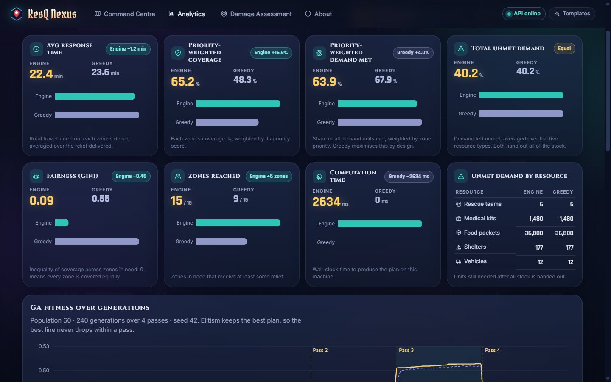

# ResQ Nexus

**Intelligent Disaster Response and Resource Allocation System**: a web-based decision-support tool
that helps a response team decide where scarce relief should go first, what to send, and why.

It follows a four-stage pipeline: **Assess → Prioritise → Allocate → Explain**.

| Stage | What it does |
|---|---|
| **Assess** | Load a disaster scenario: affected zones with damage, population, vulnerability and road access, plus the relief stock available |
| **Prioritise** | Score every zone with a transparent weighted formula plus an equity adjustment, and rank it Critical / High / Medium / Low. The weights can be changed live |
| **Allocate** | The **Allocation Engine** turns the scores and the stock into a plan: units of every resource per zone, a relief depot, a road route and a travel time, compared against a greedy baseline |
| **Explain** | Google Gemini writes a short plain-language reason for every zone's share. Without a key (or if the API fails) template explanations are used, so the demo never breaks |


## Features

- **Landing page:** gothic ResQ Nexus logo, an animated particle network, live scenario stats, a
  **Launch Command Centre** button and a card for each pipeline stage.
- **Command Centre** (main dashboard):
  - scenario selector (flood / earthquake / wildfire) with disaster-type icons
  - a large dark map: zones coloured by priority and sized by population, pulsing rings on Critical
    zones, the hazard (earthquake epicentre, fire ignition areas), relief depots, depot areas,
    the road network, and animated route lines drawn from each depot to its zones
  - priority weight sliders that re-score and recolour the zones live
  - **Run Allocation** lights up the pipeline stepper step by step while the engine runs; changing
    the weights afterwards marks the plan as out of date until it is re-run
  - KPI ribbon with animated counters: zones in need, people affected, Critical zones, depots,
    priority-weighted coverage, average response time and the Gini fairness score
  - side panel: the selected zone's details and score breakdown, its allocated resources against
    its need, depot, travel time, road distance, coverage ring, the greedy comparison and the
    explanation; plus a ranked list and the resource stock
  - toast notifications, loading and error states, keyboard access (Tab to a zone, Enter to
    select), and shareable links (`/command?scenario=earthquake-kutch&zone=EQ-04`)
- **Analytics** (Recharts): Allocation Engine vs greedy cards and bar charts for every metric, the
  GA fitness-over-generations line chart, resource distribution per zone (stacked) and per depot,
  a coverage fairness (Lorenz) curve and coverage by zone.
- **Damage Assessment:** every zone's severity with disaster-type illustrations, per-level totals and
  an "AI damage model integration in progress" banner.
- **About:** project overview, pipeline, Algorithms Used and tech stack.
- **Three demo scenarios in real Indian regions** and a **scenario generator** for new ones.
- Built for presenting: responsive from 1024 px laptops and 1280×720 projectors up to full HD,
  respects "reduce motion", and the production build splits each page into its own chunk.

| Landing page | Analytics | Damage Assessment |
|---|---|---|
|  |  |  |

## Algorithms Used

- **K-Means clustering** ([scikit-learn](https://scikit-learn.org/))
- **Dijkstra's shortest path** ([NetworkX](https://networkx.org/))
- **Genetic Algorithm** ([DEAP](https://github.com/DEAP/deap))

They are used inside the **Allocation Engine** (`backend/services/allocation_engine.py`).

## Tech stack

| Layer | Tools |
|---|---|
| Frontend | React 19, Vite 8, React Router 8, Framer Motion, Recharts, React-Leaflet 5 / Leaflet 1.9 with OpenStreetMap tiles, self-hosted Google Fonts (Pirata One, Cinzel, Inter, Rajdhani), oxlint |
| Backend | Python 3.12+ (tested on 3.13), FastAPI, Pydantic 2, NumPy, scikit-learn, NetworkX, DEAP, Uvicorn, pytest |
| AI | Google Gemini API (`google-genai`) for the Explain stage, with a template fallback |

The project started from the Script Desk template (React/Vite frontend, FastAPI backend, Gemini
client); its script-writing features and branding were removed.

## Project structure

```
resq-nexus/
├── backend/
│   ├── main.py                    FastAPI app and endpoints
│   ├── generate_scenario.py       random scenario generator (CLI)
│   ├── services/
│   │   ├── scenarios.py           scenario schema (Pydantic) and file loader
│   │   ├── priority.py            priority scoring, all settings in PRIORITY_SETTINGS
│   │   ├── demand.py              relief demand per zone (shared with the generator)
│   │   ├── allocation_engine.py   Allocation Engine + greedy baseline + metrics, settings in ENGINE_SETTINGS
│   │   ├── explain.py             per-zone explanations: Gemini with a template fallback
│   │   └── gemini_client.py       Google Gemini client
│   ├── data/
│   │   ├── regions.json           region presets: real localities, river lines, reference hazards
│   │   └── scenarios/             flood-assam.json, earthquake-kutch.json, wildfire-kumaon.json
│   ├── tests/                     pytest suite
│   ├── requirements.txt           runtime dependencies
│   ├── requirements-dev.txt       + pytest
│   └── .env.example               copy to .env and add your Gemini key
├── frontend/
│   ├── src/
│   │   ├── main.jsx               router, fonts and stylesheets
│   │   ├── App.jsx                routes, page transitions, lazy-loaded pages
│   │   ├── api.js                 API client
│   │   ├── constants.js           colours, labels, number formatting
│   │   ├── state/                 app data (scenarios, scores, allocation, pipeline) and toasts
│   │   ├── lib/                   depot-area geometry, hooks, pipeline stepper state
│   │   ├── pages/                 Landing, CommandCentre, Analytics, DamageAssessment, About
│   │   ├── components/            CommandMap, ZoneIntel, PipelineStepper, KpiRibbon, charts, ...
│   │   └── styles/                tokens.css (colours, fonts) and one stylesheet per area
│   └── .env.example               optional: API address for the dashboard
├── docs/                          screenshots used in this README
└── .github/workflows/ci.yml       tests, lint and build on every push
```

## Getting started

### Prerequisites

- **Python 3.12 or newer** (tested with 3.13; NumPy, SciPy and NetworkX need 3.12+)
- **Node.js 22.22 or newer** (required by React Router 8; tested with Node 24 and 26)

### 1. Backend (FastAPI)

```bash
cd backend
python -m venv venv
venv\Scripts\activate              # Windows
# source venv/bin/activate         # macOS / Linux
python -m pip install -r requirements-dev.txt
copy .env.example .env             # Windows  (macOS / Linux: cp .env.example .env)
uvicorn main:app --reload
```

The API runs at <http://localhost:8000>; interactive docs are at <http://localhost:8000/docs>.

**Gemini key (optional):** open `backend/.env` and set `GEMINI_API_KEY=` to your key from
<https://aistudio.google.com/apikey>, then restart the backend. Everything works without a key: the
Explain stage then uses template explanations and the dashboard shows a **Templates** badge instead
of **Gemini**. `GEMINI_MODEL` is optional (default `gemini-flash-latest`). `.env` is git-ignored,
so never commit it.

### 2. Frontend (React + Vite)

In a second terminal:

```bash
cd frontend
npm install
npm run dev
```

Open <http://localhost:5173>. The dashboard calls the API at `http://localhost:8000`. To use another
address, copy `frontend/.env.example` to `frontend/.env.local` and change `VITE_API_BASE_URL`.

### 3. Tests and checks

```bash
cd backend
python -m pytest              # 122 tests: scoring, schema, generator, Allocation Engine, API, demo data

cd ../frontend
npm run lint                  # oxlint
npm run build                 # production build into frontend/dist
```

The same checks run on GitHub Actions for every push (`.github/workflows/ci.yml`).

### Demo walkthrough (about 3 minutes)

1. **Landing page:** introduce the pipeline cards, then press **Launch Command Centre**.
2. **Command Centre:** pick **Earthquake**. Zones are coloured by priority; Bhachau and Dudhai pulse
   as Critical. Press **Run Allocation** and watch Assess → Prioritise → Allocate → Explain light up.
   Depots, depot areas and route lines appear, and the KPIs count up.
3. Click **Bhachau** (or a row in **Ranking**): show its resources against its need, the depot, the
   27-minute route, 79 % coverage, the greedy comparison and the explanation.
4. Open **Controls** and raise the severity weight: the map recolours live and the plan is marked out
   of date. Press **Re-run allocation**.
5. **Analytics:** compare the Allocation Engine with the greedy baseline and show the fitness chart.
6. **Damage Assessment** and **About** to close (Algorithms Used, tech stack).

### Troubleshooting

- **"Cannot reach the ResQ Nexus API"** in the dashboard: the backend isn't running, or it runs on another
  port. Start it with `uvicorn main:app --reload` in `backend/` and press **Retry**.
- **Explanations show a Template badge:** no `GEMINI_API_KEY` is set, or Gemini could not be reached;
  the toast after a run says which. Add the key to `backend/.env` and restart the backend.
- **Port 8000 already in use:** run `uvicorn main:app --reload --port 8001` and set
  `VITE_API_BASE_URL=http://localhost:8001` in `frontend/.env.local`.
- **PowerShell refuses to run `activate`:** run
  `Set-ExecutionPolicy -Scope CurrentUser RemoteSigned` once, or use Command Prompt.

## API endpoints

| Method | Path | Returns |
|---|---|---|
| GET | `/health` | `{"status": "ok", ..., "gemini_configured": false}` |
| GET | `/scenarios` | List of scenarios: `id`, `name`, `disaster_type`, `region`, `state`, `zone_count`, `total_population`, `synthetic` |
| GET | `/scenarios/{id}` | The full scenario: metadata, hazard parameters, available `resources` and every zone |
| GET | `/scenarios/{id}/priority` | Zones sorted by priority with `rank`, `priority_score`, `priority_level`, normalised `factors` and weighted `contributions`, plus a `summary` (zones per level) and the `settings` used. Optional query parameters `severity`, `population`, `vulnerability`, `accessibility` re-score with custom weights |
| POST | `/scenarios/{id}/allocate` | Allocation Engine and greedy baseline results: per-zone allocation, depot, route and travel time, `depots`, `roads`, comparison `metrics` for both methods and the GA `fitness_history` |
| POST | `/scenarios/{id}/explain` | A plain-language explanation for every zone of the same plan, with its `source` (`gemini` or `template`) |

Both POST endpoints take an optional body with custom priority weights (any non-negative numbers;
they are rescaled to sum to 1, and missing ones keep their default):

```json
{ "weights": { "severity": 0.6, "population": 0.2, "vulnerability": 0.1, "accessibility": 0.1 } }
```

Unknown scenario ids return `404`; negative or all-zero weights and unknown fields return `422`.
Results are deterministic, so repeated requests for the same scenario and weights are served from a
small cache.

### `/allocate` example

```bash
curl -X POST http://localhost:8000/scenarios/earthquake-kutch/allocate
```

Excerpt (one zone, both methods' metrics):

```json
{
  "scenario_id": "earthquake-kutch",
  "seed": 42,
  "resources": { "rescue_teams": 8, "medical_kits": 1530, "food_packets": 38300, "shelters": 194, "vehicles": 16 },
  "zones": [
    {
      "id": "EQ-04", "name": "Bhachau", "damage_severity": 3, "population": 42000,
      "priority_score": 0.7299, "priority_level": "Critical", "rank": 1,
      "demand": { "rescue_teams": 2, "medical_kits": 1260, "food_packets": 31500, "shelters": 210, "vehicles": 3 },
      "engine": {
        "allocated": { "rescue_teams": 2, "medical_kits": 978, "food_packets": 25130, "shelters": 148, "vehicles": 2 },
        "coverage_pct": 78.9,
        "depot_id": "D4",
        "route": ["D4", "EQ-04"],
        "travel_time_min": 27.1,
        "distance_km": 14.11
      },
      "greedy": { "allocated": { "...": "..." }, "coverage_pct": 100.0, "depot_id": "D4", "travel_time_min": 27.1 }
    }
  ],
  "engine": {
    "metrics": {
      "avg_response_time_min": 22.4, "coverage_pct": 65.2, "demand_met_pct": 63.9,
      "unmet_demand": { "rescue_teams": 6, "medical_kits": 1480, "food_packets": 36800, "shelters": 177, "vehicles": 12 },
      "unmet_demand_pct": 40.2, "gini": 0.088, "computation_ms": 2626.2, "zones_in_need": 15, "zones_served": 15
    }
  },
  "greedy": {
    "metrics": {
      "avg_response_time_min": 23.6, "coverage_pct": 48.3, "demand_met_pct": 67.9,
      "unmet_demand_pct": 40.2, "gini": 0.552, "computation_ms": 0.2, "zones_in_need": 15, "zones_served": 9
    }
  },
  "fitness_history": [{ "pass": 1, "generation": 1, "best": 0.452898, "mean": 0.438102 }, "..."]
}
```

(`resources` here is the scenario's stock. The full response also lists `depots`, `roads`, `passes`
and the `settings` used.)

### `/explain` example

```bash
curl -X POST http://localhost:8000/scenarios/earthquake-kutch/explain
```

```json
{
  "scenario_id": "earthquake-kutch",
  "source": "template",
  "model": null,
  "notice": "GEMINI_API_KEY is not set, so these explanations come from templates.",
  "explanations": [
    {
      "zone_id": "EQ-04",
      "text": "Bhachau is a Critical-priority zone (rank 1 of 19): an earthquake that destroyed most buildings affects about 42,000 people. The Allocation Engine sends 2 rescue teams, 978 medical kits, 25,130 food packets, 148 shelter units and 2 vehicles from Depot D over limited roads, about 27 minutes away, covering 79% of its estimated needs. That is above the regional average of 64% because its needs are among the most urgent.",
      "source": "template"
    }
  ]
}
```

With a key, `source` is `gemini` and `model` names the Gemini model. Zones are sent in batches of up
to 10 (two requests for 19 zones, run in parallel) with a 25-second timeout. Each request asks for
2–3 sentences per zone covering damage, population, vulnerability, road access, travel time and
fairness, using only the facts it is given. Any zone missing from the reply, or in a batch that
fails, falls back to its template: `source` is then `mixed`, or `template` if nothing came back,
and `notice` says why. `/explain` always returns an explanation for every zone.

## Allocation Engine

`backend/services/allocation_engine.py` turns the priority scores and the scenario's stock into an
allocation plan. For each zone it returns:

- the units of each resource it receives (`allocated`)
- the relief depot that serves it (`depot_id`)
- the road route from that depot (`route`, `route_coords`), the travel time and the distance
- `coverage_pct`: the share of its estimated need that is covered, averaged over the resources it needs

It also returns the relief depots, the synthetic road network drawn on the map, and the GA fitness
per generation for the Analytics chart. All tunable numbers live in `ENGINE_SETTINGS`. The tests
check that:

- no resource is ever allocated beyond the available stock
- results are reproducible: the same scenario, weights and seed (42) always give the same plan
- every demo scenario finishes in under 5 seconds (about 2.2–2.8 s on a laptop)
- every zone in need gets some relief, and coverage follows the priority levels

### Relief demand

Each zone's need comes from its damage severity and population (`backend/services/demand.py`, the
same model the generator uses to size the stock):

| Resource | Need per zone (severity 0 / 1 / 2 / 3) |
|---|---|
| Rescue teams | 0 / 0 / 1 / 2 |
| Vehicles | 0 / 1 / 2 / 3 |
| Food packets (one day) | one per affected person: population × 0 / 10 % / 35 % / 75 % |
| Medical kits | one per 25 affected people |
| Shelter units | one per 100 displaced people: population × 0 / 2 % / 15 % / 50 % displaced |

Example: Bhachau (destroyed, 42,000 people) needs 2 rescue teams, 3 vehicles, 31,500 food packets,
1,260 medical kits and 210 shelter units.

### Greedy baseline

For comparison, the greedy baseline serves zones in priority order: each zone takes everything it
needs from the remaining stock, delivered from its nearest depot (same depots and roads), until the
stock runs out.

### Metrics

Both methods are measured with the same metrics:

| Metric | Meaning |
|---|---|
| `avg_response_time_min` | road travel time from each zone's depot, averaged over the relief delivered |
| `coverage_pct` | each zone's coverage %, weighted by its priority score (zones in need only) |
| `demand_met_pct` | share of demand units met, weighted by zone priority and averaged over resource types |
| `unmet_demand` / `unmet_demand_pct` | units still needed per resource, and the unmet share of the need averaged over resource types |
| `gini` | Gini coefficient of coverage across zones in need (0 = every zone equally covered) |
| `computation_ms` | wall-clock time to produce the plan |
| `zones_served` / `zones_in_need` | zones in need that receive at least some relief |

Results for the three demo scenarios (default weights):

| Scenario | Method | Avg response | Weighted coverage | Demand met | Unmet demand | Gini | Zones reached | Time |
|---|---|---|---|---|---|---|---|---|
| `flood-assam` | Allocation Engine | 17.7 min | 62.5 % | 60.5 % | 40.9 % | 0.077 | 13 / 13 | 2.7 s |
| | Greedy | 22.0 min | 46.3 % | 65.5 % | 40.9 % | 0.625 | 6 / 13 | 0.3 ms |
| `earthquake-kutch` | Allocation Engine | 22.4 min | 65.2 % | 63.9 % | 40.2 % | 0.088 | 15 / 15 | 2.6 s |
| | Greedy | 23.6 min | 48.3 % | 67.9 % | 40.2 % | 0.552 | 9 / 15 | 0.2 ms |
| `wildfire-kumaon` | Allocation Engine | 13.7 min | 52.4 % | 59.0 % | 43.9 % | 0.140 | 11 / 11 | 2.2 s |
| | Greedy | 12.6 min | 40.7 % | 62.5 % | 43.9 % | 0.670 | 5 / 11 | 0.2 ms |

How to read it: the stock is deliberately smaller than the need, so both methods hand out everything
and leave the same total unmet. The greedy baseline fully supplies the top few zones and leaves the
rest with nothing. That gives it slightly more raw demand met, but much lower weighted coverage, a
far less even spread (higher Gini) and fewer zones reached. The Allocation Engine reaches every zone
in need and gives the most urgent ones the highest coverage. Its response time is lower in two of
the three scenarios; in the wildfire scenario greedy is about a minute faster.

## Priority model

Implemented in `backend/services/priority.py`:

```
priority = w1·severity + w2·population + w3·vulnerability + w4·(1 − accessibility) + equity_adjustment
```

Each factor is normalised to 0–1 first:

| Factor | Normalisation | Default weight |
|---|---|---|
| severity | `damage_severity / 3` | w1 = 0.40 |
| population | min–max across the scenario's zones on a log scale, so one large town doesn't flatten every village to 0 (set `"population_scaling": "linear"` for plain min–max) | w2 = 0.25 |
| vulnerability | `vulnerability_index` (already 0–1) | w3 = 0.20 |
| accessibility | used as `1 − accessibility`, so poor road access raises priority | w4 = 0.15 |

**Equity adjustment.** A damaged zone whose road access is below **0.30** gets a small extra boost
that grows linearly to **+0.05** at access 0. Remote areas are the ones most likely to be served
last because they are hard to reach; the boost keeps them from being deprioritised for that reason.
Undamaged zones get no boost.

**Levels.** Critical ≥ 0.70, High ≥ 0.50, Medium ≥ 0.30, otherwise Low.

**Configuration.** Every number above (weights, scaling, equity threshold and size, level
thresholds) lives in the single `PRIORITY_SETTINGS` dict at the top of `priority.py`.
`score_zones(zones, settings)` also accepts a modified copy for experiments, and the Command
Centre's sliders (or the weight parameters of `/priority`, `/allocate` and `/explain`) change the
weights per request. Custom weights are rescaled to sum to 1, so scores stay in 0–1 and the level
thresholds keep their meaning.

**Worked example** (Kalgachia, flood scenario):

| Factor | Value | Normalised | × weight |
|---|---|---|---|
| Damage | 3 (destroyed) | 1.000 | 0.400 |
| Population | 12,000 | 0.437 | 0.109 |
| Vulnerability | 0.49 | 0.490 | 0.098 |
| Road access | 0.24 | 1 − 0.24 = 0.760 | 0.114 |
| Equity boost | access 0.24 < 0.30 | 0.05 × (0.30 − 0.24) / 0.30 | 0.010 |
| **Priority** | | | **0.731 → Critical** |

## Scenario data

### Format

Each scenario is one JSON file in `backend/data/scenarios/<id>.json` (the file name is the id):

```json
{
  "id": "flood-assam",
  "name": "Brahmaputra & Beki floods – Barpeta, Assam",
  "disaster_type": "flood",
  "region": "Barpeta, Bajali, Nalbari and Kamrup districts",
  "state": "Assam",
  "description": "Hypothetical monsoon flood along the Brahmaputra and Beki rivers. ...",
  "synthetic": true,
  "data_note": "SYNTHETIC demo data. ...",
  "hazard": { "model": "river-distance", "rivers": ["Brahmaputra", "Beki"], "extent_km": 9.0 },
  "generator": { "script": "generate_scenario.py", "seed": 8, "preset_hazard": true, "scarcity": 0.6 },
  "resources": { "rescue_teams": 8, "medical_kits": 1530, "food_packets": 38300, "shelters": 194, "vehicles": 16 },
  "zones": [
    {
      "id": "FL-07", "name": "Kalgachia", "latitude": 26.36013, "longitude": 90.87007,
      "disaster_type": "flood", "damage_severity": 3, "population": 12000,
      "vulnerability_index": 0.49, "accessibility": 0.24
    }
  ]
}
```

| Zone field | Meaning |
|---|---|
| `damage_severity` | 0 none, 1 minor, 2 major, 3 destroyed |
| `population` | residents in the zone |
| `vulnerability_index` | 0–1; 1 = most vulnerable (e.g. poverty, weak housing, elderly residents) |
| `accessibility` | 0–1; 1 = easy road access, 0 = cut off |

Resources are counted as rescue teams, medical kits, one-day food packets, shelter units and
vehicles (trucks, boats, ambulances); see [Relief demand](#relief-demand) for how much each zone needs.

### Demo scenarios

| id | Disaster | Region | Zones | What to look at |
|---|---|---|---|---|
| `flood-assam` | Brahmaputra & Beki floods | Barpeta, Bajali, Nalbari and Kamrup districts, Assam | 19 | Riverine *char* villages cut off by water (Baghbor, Chenga) top the list |
| `earthquake-kutch` | M6.9 earthquake (hypothetical, in the source zone of the 2001 Bhuj earthquake) | Kachchh, Gujarat | 19 | Bhachau is destroyed and ranks first; remote Dholavira on Khadir Bet is lifted by the equity boost |
| `wildfire-kumaon` | Pre-monsoon forest fires from three ignition areas (Binsar, Syahi Devi, Jageshwar) | Almora & Bageshwar, Uttarakhand | 19 | Forest-edge hamlets with poor road access outrank larger towns |

> **This is synthetic demo data.** Zone names and coordinates are real places (OpenStreetMap via
> Nominatim; river lines from OpenStreetMap). Populations are rounded approximations. Damage,
> vulnerability, accessibility and resource figures come from the generator's hazard model and are
> not real observations. Every file carries `"synthetic": true` and a `data_note` saying so.

The three files were produced with the generator, so they can be regenerated:

```bash
cd backend
python generate_scenario.py --type flood      --region assam-barpeta --preset-hazard --seed 8  --id flood-assam      --force
python generate_scenario.py --type earthquake --region kutch         --preset-hazard --seed 31 --id earthquake-kutch --force
python generate_scenario.py --type wildfire   --region kumaon        --preset-hazard --seed 14 --id wildfire-kumaon  --force
```

### Generating new scenarios

```bash
cd backend
python generate_scenario.py --list-regions

# Random earthquake in Kutch: random epicentre and magnitude, real localities
python generate_scenario.py --type earthquake --region kutch --seed 42

# 15 of the Kumaon localities with random fire ignition points, printed instead of saved
python generate_scenario.py --type wildfire --region kumaon --zones 15 --stdout

# Synthetic zones anywhere in India (here around Darbhanga, Bihar)
python generate_scenario.py --type flood --center 26.15,85.90 --radius-km 30 --region-name "Darbhanga, Bihar" --state Bihar
```

New files go to `backend/data/scenarios/<id>.json` and appear in the scenario selector after a page
refresh (no restart needed). Useful options: `--seed` (reproducible), `--zones 15-20`,
`--magnitude`, `--scarcity` (resources as a fraction of the estimated need), `--id`, `--name`,
`--out`, `--force` (overwrite; existing files are otherwise protected). Run with `--help` for all options.
`--center` scatters zones evenly within the radius and doesn't know where the coast is, so near the
sea pick an inland centre or a smaller `--radius-km`.

**How damage is generated.** Each disaster type has a simple, explainable hazard model:

- earthquake: intensity `1 / (1 + (d/D)²)` from the epicentre, where `D` grows with magnitude
- flood: `exp(−d / extent)` from the river lines (the real Brahmaputra and Beki centrelines for Assam)
- wildfire: `exp(−d / spread)` from the nearest ignition area

A settlement-type adjustment is added (riverine and forest-edge hamlets are more exposed, cities
less), then noise. Intensity maps to damage 3 / 2 / 1 / 0 at 0.70 / 0.45 / 0.20. Road access falls
as intensity rises. Available resources are a fraction of the estimated need, so the Allocate
stage has real trade-offs to make.

## Next steps

- **AI damage assessment:** replace the scenario's damage values with a model (e.g. from satellite
  or drone imagery); the Damage Assessment page is ready for it.
- **Real road data:** the road network is synthetic (each zone and depot is linked to its nearest
  neighbours); OpenStreetMap roads would give real routes and travel times.

## Credits

- Map data © [OpenStreetMap contributors](https://www.openstreetmap.org/copyright) (ODbL). Map
  tiles come from `tile.openstreetmap.org`, which suits light demo use under the OSM tile usage policy.
- Fonts: Pirata One, Cinzel, Inter and Rajdhani (SIL Open Font License), self-hosted via Fontsource.
- Built on the Script Desk template (React/Vite + FastAPI + Google Gemini).
